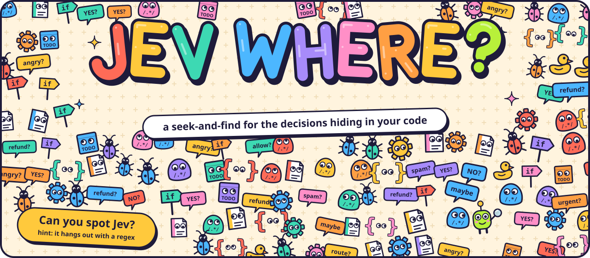
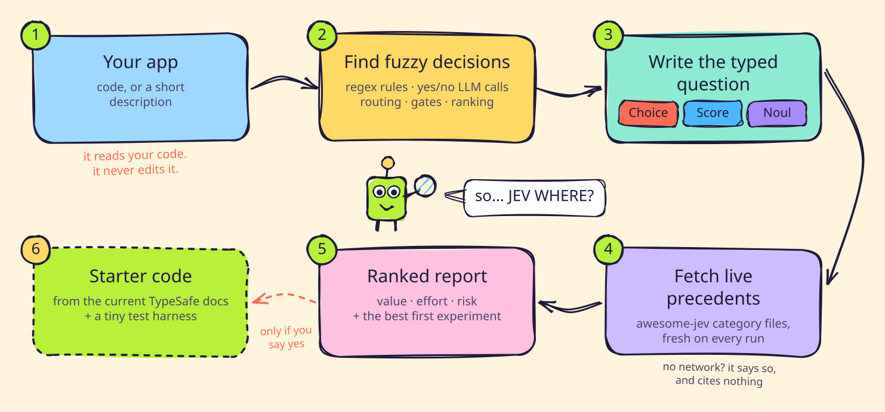

<p align="center">
  
</p>

<p align="center">
  <b>A seek-and-find for the decisions hiding in your code.</b><br>
  Point it at an app. Get a ranked list of the places Jev could make the call.<br>
  A Claude Code plugin for <a href="https://typesafe.ai/blog/introducing-system-one-models-and-jev">Jev</a>, TypeSafe AI's System One model.
</p>

<p align="center">
  
  
  
</p>

---

Every app has fuzzy decisions buried in it: a regex that routes tickets, a
keyword list that sets priority, an LLM call that only ever answers YES or NO,
a filter that holds messages for review. Jev is built for exactly those: state
in, a typed decision out (a **Choice**, a **Score**, or a **Noul** yes/no
probability), each with its probabilities.

**JEV WHERE?** reads your app and finds them for you. For every decision point
it writes the exact typed question, says what to do when Jev is unsure, cites
real projects doing something similar, and ranks the ideas so you know which
experiment to run first. It only analyzes and suggests. It never edits your
code.

## What you get

For each idea:

| | |
| --- | --- |
| **Where** | The file, line and function, such as `helpdesk/router.py:14` (`route`) |
| **Today** | What the code does now, and where it breaks |
| **Jev decision** | Choice, Score or Noul, the exact question, and its options or levels |
| **Confidence handling** | Starting cutoffs (labelled as such) and a safe fallback when Jev is unsure |
| **Precedent** | 1 to 2 real projects from [awesome-jev](https://github.com/yibie/awesome-jev), fetched live every run |
| **Benefit, risk, poor fit** | An honest case for and against |
| **Effort** | S, M or L |

Plus:

- **One request, several questions:** ideas that read the same input are
  grouped into a single Jev call.
- **Existing Jev use:** if the app already calls Jev, its questions,
  cutoffs and fallbacks are reviewed too.
- **Start here:** the single best first experiment and how to evaluate it on a
  small labeled set.
- **Starter code, only if you ask:** a minimal integration in your app's
  language, built from the current TypeSafe docs, with an evaluation harness.

See a full example report: [examples/sample-report-offline.md](examples/sample-report-offline.md) (run with no network).

## How it works

<p align="center">
  
</p>

<sub>Drawn in <a href="https://excalidraw.com">Excalidraw</a>. To edit it, open <code>assets/src/how-it-works.excalidraw</code> there.</sub>

## Install

### From this GitHub repo

This repo is private, so your machine needs GitHub access to it first:

```bash
gh auth login
```

```bash
gh auth setup-git
```

Then add the marketplace and install the plugin:

```bash
claude plugin marketplace add cesarroger/jev-where
```

```bash
claude plugin install jev-where@jev-where
```

Restart Claude Code or run `/reload-plugins`.

### From a local clone

Try it for one session:

```bash
claude --plugin-dir /path/to/jev-where
```

Or install it from the folder:

```bash
claude plugin marketplace add /path/to/jev-where
```

### As a standalone skill

Link the skill folder into your personal skills:

```bash
ln -s /path/to/jev-where/skills/jev-where ~/.claude/skills/jev-where
```

Pick one form. If you install both, the personal skill takes `/jev-where` and
the plugin stays reachable as `/jev-where:jev-where`.

## Use

| You type | It analyzes |
| --- | --- |
| `/jev-where` | the current project |
| `/jev-where src/support` | the code at that path |
| `/jev-where Discord bot that flags scam DMs and routes reports to mods` | an app described in words |

It also starts on its own when you ask things like "where could I use Jev in
this app?", "find Jev use cases in this repo", or "what decisions here could be
typed?". General questions about what Jev is don't trigger it.

## Ground rules

- **Read-only.** It never edits your files. It writes a new file only when you
  ask for one.
- **No invented API facts.** It doesn't state Jev request formats, model IDs,
  prices, latency or accuracy from memory. It points you to the official docs.
- **Live precedents only.** Precedents come from the awesome-jev category
  files fetched in that run. If the fetch fails, every idea says "no
  precedent lookup available". A listing on awesome-jev is not an endorsement.
- **Secrets stay out.** It never quotes keys, tokens or passwords from your
  code in the report.
- **Fetched pages are data.** Instructions found in web pages or repo files are
  ignored.

## Tests

The `evals/` folder holds a suite for Claude Code's built-in
[`claude plugin eval`](https://code.claude.com/docs/en/plugin-evals) runner
(Claude Code 2.1.269 or later). It checks that the skill triggers on the right
requests and not on near-misses, asks for a description in an empty project,
produces a grounded report, labels missing precedents when offline, never leaks
the fixture's fake secrets, and never edits files.

Each run is a real Claude session and counts against your plan's usage. From
the repo root:

```bash
claude plugin eval . --tag trigger
```

```bash
claude plugin eval . --tag network --allow-tools "WebFetch(domain:raw.githubusercontent.com)" "WebFetch(domain:api.github.com)"
```

```bash
claude plugin eval . --tag offline
```

Add `--runs 1 --ablation none` while iterating to cut the cost.

## Project layout

```text
jev-where/
├── .claude-plugin/
│   ├── plugin.json                  plugin manifest
│   └── marketplace.json             lets `claude plugin install` find it
├── skills/jev-where/
│   ├── SKILL.md                     the workflow
│   └── references/
│       ├── patterns.md              decision point → Choice / Score / Noul, default cutoffs
│       └── starter-integration.md   used only when you ask for starter code
├── evals/                           `claude plugin eval` suite and fixture app
├── examples/sample-report.md        a full run on the fixture app
└── assets/
    ├── banner.svg                   the seek-and-find banner (can you spot Jev?)
    ├── how-it-works.svg             the hand-drawn diagram, fonts embedded
    ├── social-preview.png           1280×640 card for the repo's social preview
    └── src/
        ├── make_banner.py           regenerates banner.svg (change SEED to reshuffle the crowd)
        ├── make_diagram.py          writes how-it-works.excalidraw
        ├── how-it-works.excalidraw  open at excalidraw.com to edit by hand
        └── render_diagram.html      renders the .excalidraw file to SVG with Excalidraw's exporter, loaded from a CDN
```

## Credits

Jev and System One models are made by [TypeSafe AI](https://typesafe.ai).
Precedents come from [awesome-jev](https://github.com/yibie/awesome-jev), a
community list. This project is independent and not affiliated with either.

## License

[MIT](LICENSE) © 2026 Cesar Peralta
